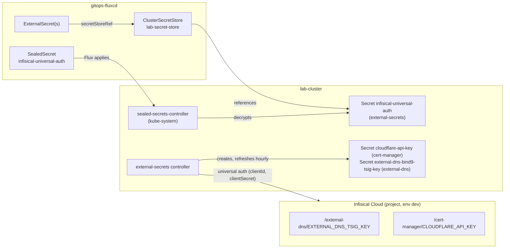

# Store lab secrets in Infisical with External Secrets

This playbook shows how the lab keeps secrets out of Git: values live in Infisical, External Secrets Operator (ESO) syncs them into Kubernetes `Secret` objects, and the only secret committed to Git is the Infisical machine-identity credential, encrypted as a SealedSecret.

Use it to add a new secret to the cluster, rotate one, or rebuild the chain after re-creating the cluster.

| Item | Details |
|---|---|
| **Stack** | External Secrets Operator chart `2.12.0` (API `external-secrets.io/v1`)<br>Sealed Secrets chart `2.20.0`<br>Infisical Cloud (`https://app.infisical.com`)<br>Flux |
| **Target** | Kube context `lab-cluster`<br>Infisical environment `dev` |
| **Run from** | Fedora 44 host |
| **Env** | lab |

The manifests live in [`gitops-fluxcd`](https://github.com/riupie/gitops-fluxcd) under `infrastructure/`; this repo only documents them.

!!! warning "Lab-only shortcuts"
    The `ClusterSecretStore` has no namespace conditions, so an `ExternalSecret` in any namespace can read any path of the project environment. Infisical `secretsPath` is not a security boundary either; scope the machine identity in Infisical instead. For anything shared, limit the store with `spec.conditions[].namespaces` and give each component its own identity.

## Prerequisites

- [ ] `kubectl` context `lab-cluster` and the Flux setup from [Kubernetes Setup](../getting-started/kubernetes-setup.md): `kubectl --context lab-cluster -n flux-system get kustomization infrastructure infrastructure-configs`
- [ ] The `external-secrets` and `sealed-secrets` HelmReleases are `Ready`: `kubectl --context lab-cluster get helmrelease -A`
- [ ] An Infisical account with a project and an environment with slug `dev`
- [ ] `kubeseal` on the host that matches the controller, from the [Sealed Secrets releases](https://github.com/bitnami-labs/sealed-secrets/releases): `kubeseal --version`
- [ ] The `flux` CLI on the host: `flux --version`
- [ ] A checkout of `gitops-fluxcd`; commands marked *On the host* run from its root

## Steps

### 1. Review the model



| Piece | Where | Purpose |
|---|---|---|
| Infisical project, environment `dev`, folders `/external-dns` and `/cert-manager` | Infisical Cloud | Source of truth for secret values |
| Machine identity with Universal Auth | Infisical Cloud | Read-only credential that ESO uses |
| `SealedSecret` `infisical-universal-auth` | `infrastructure/overlays/development/configs/external-secrets/` | Holds `clientId` and `clientSecret`, encrypted for this cluster |
| `ClusterSecretStore` `lab-secret-store` | same directory | Tells ESO how to reach the Infisical project |
| `ExternalSecret` per consumer | `infrastructure/overlays/development/<component>/external-secret.yaml` | Maps one Infisical key to one key of a Kubernetes `Secret` |

Current consumers:

| ExternalSecret (namespace) | Infisical key | Target `Secret` and key | Used by |
|---|---|---|---|
| `cloudflare-api-key` (`cert-manager`) | `/cert-manager/CLOUDFLARE_API_KEY` | `cloudflare-api-key`, `api-key` | `ClusterIssuer` `letsencrypt-production` (DNS-01 via Cloudflare) |
| `external-dns-bind9-tsig-key` (`external-dns`) | `/external-dns/EXTERNAL_DNS_TSIG_KEY` | `external-dns-bind9-tsig-key`, `ddns-key` | External-DNS RFC2136 provider, see [Dynamic DNS](dynamic-dns.md) |

### 2. Create the secrets in Infisical

*Infisical console, project, environment `dev`:*

1. Create the folders `/external-dns` and `/cert-manager`.
2. Add one secret per consumer, with the exact names the `ExternalSecret` objects reference:
    - `/external-dns/EXTERNAL_DNS_TSIG_KEY`: the TSIG secret from [Dynamic DNS step 7](dynamic-dns.md#7-hand-the-tsig-secret-to-external-dns)
    - `/cert-manager/CLOUDFLARE_API_KEY`: a Cloudflare API token that can edit DNS for the zone

The leading slash in the key makes the path absolute. The `secretsPath` in the store is then ignored for that key.

### 3. Create the machine identity

*Infisical console.* Create a **machine identity** with the **Universal Auth** method, add it to the project, and give it read access to the `dev` environment. Create a client secret and note the **Client ID** and **Client Secret**.

The console labels move between Infisical releases; follow the Infisical Universal Auth documentation if a menu differs. Use a read-only role: the lab only pulls secrets.

### 4. Seal the credential

*On the host.* Read the two values without echoing them or writing them to shell history, then seal them against the cluster's controller:

```bash
read -rsp 'clientId: ' CLIENT_ID; echo
read -rsp 'clientSecret: ' CLIENT_SECRET; echo

kubectl --context lab-cluster -n external-secrets create secret generic infisical-universal-auth \
  --from-literal=clientId="$CLIENT_ID" --from-literal=clientSecret="$CLIENT_SECRET" \
  --dry-run=client -o yaml \
| kubeseal --context lab-cluster --controller-name sealed-secrets-controller \
    --controller-namespace kube-system --format yaml \
  > infrastructure/overlays/development/configs/external-secrets/secret-infisical-universal-auth.yaml

unset CLIENT_ID CLIENT_SECRET
```

The Secret is created in the `external-secrets` namespace because the store reads it from there, and a SealedSecret is bound to its name and namespace by default.

The controller is named `sealed-secrets-controller` through `fullnameOverride` in the HelmRelease; without these flags `kubeseal` looks for a controller with a different name.

### 5. Define the store

*On the host.* Edit `infrastructure/overlays/development/configs/external-secrets/cluster-secret-store.yaml`:

```yaml
apiVersion: external-secrets.io/v1
kind: ClusterSecretStore
metadata:
  name: lab-secret-store
spec:
  provider:
    infisical:
      hostAPI: https://app.infisical.com
      auth:
        universalAuthCredentials:
          clientId:
            name: infisical-universal-auth
            namespace: external-secrets     # required for a ClusterSecretStore
            key: clientId
          clientSecret:
            name: infisical-universal-auth
            namespace: external-secrets
            key: clientSecret
      secretsScope:
        projectSlug: <project-slug>         # see the project settings in Infisical
        environmentSlug: dev
        secretsPath: /
```

### 6. Add an ExternalSecret for each consumer

*On the host.* Put the manifest next to the component that uses it, in `infrastructure/overlays/development/<component>/external-secret.yaml`, and list it in that directory's `kustomization.yaml`:

```yaml
apiVersion: external-secrets.io/v1
kind: ExternalSecret
metadata:
  name: cloudflare-api-key
  namespace: cert-manager
spec:
  refreshInterval: 1h
  secretStoreRef:
    kind: ClusterSecretStore
    name: lab-secret-store
  target:
    name: cloudflare-api-key        # name of the Kubernetes Secret to create
    creationPolicy: Owner
  data:
    - secretKey: api-key            # key inside that Secret
      remoteRef:
        key: /cert-manager/CLOUDFLARE_API_KEY
```

Reference the Secret from the workload as usual, for example the `ClusterIssuer` uses `apiTokenSecretRef: {name: cloudflare-api-key, key: api-key}`, and External-DNS reads `ddns-key` through `secretKeyRef` in its Helm values.

### 7. Commit and reconcile

*On the host.* Commit the SealedSecret, the store and the ExternalSecrets to `gitops-fluxcd`, then:

```bash
flux --context lab-cluster reconcile kustomization infrastructure --with-source
flux --context lab-cluster reconcile kustomization infrastructure-configs
```

Flux applies them in order: `infrastructure` installs the ESO and Sealed Secrets charts (with CRDs) and waits; `infrastructure-configs` depends on it and applies the store and the SealedSecret.

On a first bootstrap, the `ExternalSecret` objects can fail once with `no matches for kind "ExternalSecret"` because they sit in the same Kustomization as the chart that installs the CRDs. The `retryInterval` of 1 minute clears it.

### 8. Rotate a secret (when needed)

*On the host:*

1. Change the value in Infisical.
2. Force a sync instead of waiting up to `refreshInterval` (1 hour):

    ```bash
    kubectl --context lab-cluster -n cert-manager annotate externalsecret cloudflare-api-key \
      force-sync="$(date +%s)" --overwrite
    ```

3. Restart workloads that read the value as an environment variable, because pods do not see a changed `Secret` in env vars. External-DNS is one of them:

    ```bash
    kubectl --context lab-cluster -n external-dns rollout restart deployment external-dns
    ```

The TSIG key must also change on BIND9: generate a new key as in [Dynamic DNS step 3](dynamic-dns.md#3-generate-the-tsig-key) first, then store it in Infisical.

### 9. Rotate the Infisical credential (when needed)

Create a new client secret on the machine identity, repeat [step 4](#4-seal-the-credential), commit, and reconcile (step 7). The store picks up the new values on its next refresh; confirm with `kubectl --context lab-cluster get clustersecretstore`. Then revoke the old client secret in Infisical.

## Verify

*On the host:*

### 1. Flux objects

```bash
kubectl --context lab-cluster get sealedsecret -n external-secrets
kubectl --context lab-cluster get clustersecretstore
kubectl --context lab-cluster get externalsecret -A
```

Expected output:

```text
NAMESPACE          NAME                       STATUS   SYNCED   AGE
external-secrets   infisical-universal-auth            True     ...

NAME               AGE   STATUS   CAPABILITIES   READY
lab-secret-store   ...   Valid    ReadWrite      True

NAMESPACE      NAME                          STORETYPE            STORE              REFRESH INTERVAL   STATUS         READY
cert-manager   cloudflare-api-key            ClusterSecretStore   lab-secret-store   1h                 SecretSynced   True
external-dns   external-dns-bind9-tsig-key   ClusterSecretStore   lab-secret-store   1h                 SecretSynced   True
```

### 2. Target secrets

Check that the target Secrets exist and have the expected keys, without printing the values:

```bash
kubectl --context lab-cluster -n cert-manager get secret cloudflare-api-key -o json | jq '.data | keys'
kubectl --context lab-cluster -n external-dns get secret external-dns-bind9-tsig-key -o json | jq '.data | keys'
```

Expected output: `["api-key"]` and `["ddns-key"]`.

## Troubleshooting

| Symptom | Likely cause | Fix |
|---|---|---|
| `SealedSecret` `SYNCED` is empty or the event says `no key could decrypt secret` | Sealed against another cluster, or the name/namespace changed | Re-seal ([step 4](#4-seal-the-credential)); name `infisical-universal-auth`, namespace `external-secrets` |
| `ClusterSecretStore` is not `Valid` / `READY` is `False` | Credentials Secret missing in `external-secrets`, wrong `key` names, or a wrong `projectSlug`/`environmentSlug` | `kubectl --context lab-cluster describe clustersecretstore lab-secret-store`; compare with [step 5](#5-define-the-store) |
| `ExternalSecret` is `SecretSyncedError`, message says the secret is not found | Wrong `remoteRef.key`: missing leading `/`, wrong folder, or wrong name case | Open the key in Infisical and copy the exact path: `/<folder>/<NAME>` |
| Store is `Valid` but a key is not found, or access is denied | The machine identity has no access to that environment or folder | Add the identity to the project with read access to `dev` |
| Everything worked, then all `ExternalSecret`s fail with an authentication error | The client secret was revoked or expired | Create a new client secret and re-seal ([step 9](#9-rotate-the-infisical-credential-when-needed)) |
| Secret updated in Infisical but the app still uses the old value | Refresh interval not reached, or the app reads it from an env var | Force-sync and restart the workload ([step 8](#8-rotate-a-secret-when-needed)) |
| `no matches for kind "ExternalSecret"` right after bootstrap | CRDs are installed by the chart in the same Kustomization | Wait for the 1-minute retry, or `flux reconcile kustomization infrastructure` |

## Rollback

- **One consumer:** `creationPolicy: Owner` means ESO owns the target `Secret`. Deleting the `ExternalSecret` (or removing it from Git, which Flux then prunes) deletes the `Secret` too, and the workload loses its credential. Remove the reference from the workload first.
- **Whole chain:** revert the commit in `gitops-fluxcd` and reconcile. The target Secrets disappear with their `ExternalSecret`s, and the values stay in Infisical.
- **Emergency fallback:** delete the `ExternalSecret` first, then create the target Secret by hand with the same name and keys, so ESO and you do not fight over the same object.
- **After rebuilding the cluster:** a SealedSecret can only be decrypted by the controller key that sealed it, so the committed `infisical-universal-auth` no longer decrypts on a new cluster. Redo [step 4](#4-seal-the-credential) against the new controller and commit, or restore the controller's key Secret from a backup before Flux applies it. Everything else comes back from Infisical on its own.

## References

- [External Secrets Operator: Infisical provider](https://external-secrets.io/latest/provider/infisical/)
- [Infisical: Universal Auth](https://infisical.com/docs/documentation/platform/identities/universal-auth)
- [Sealed Secrets](https://github.com/bitnami-labs/sealed-secrets)
